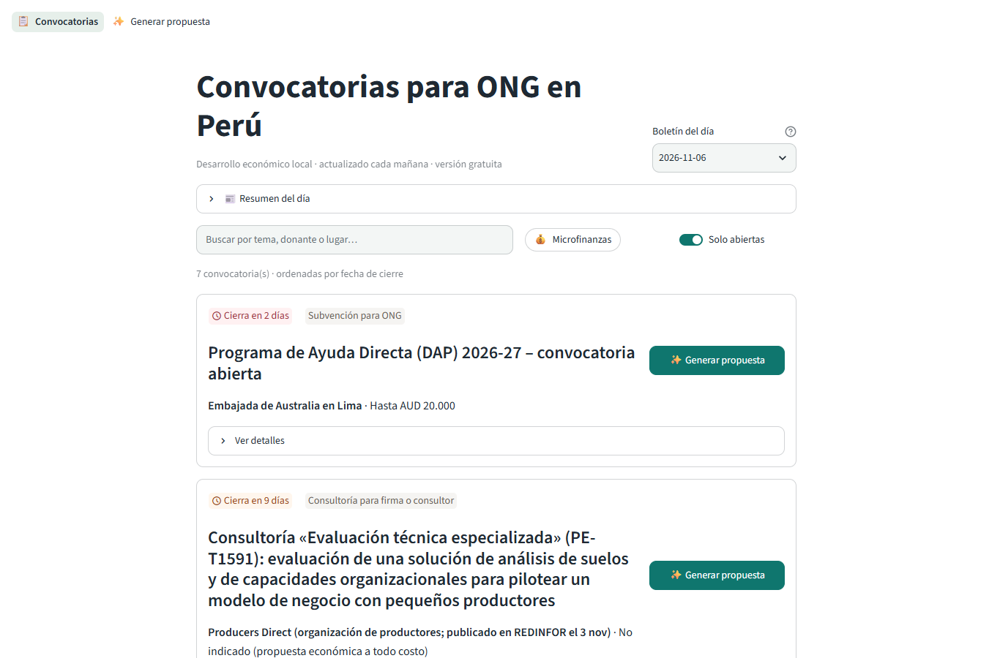
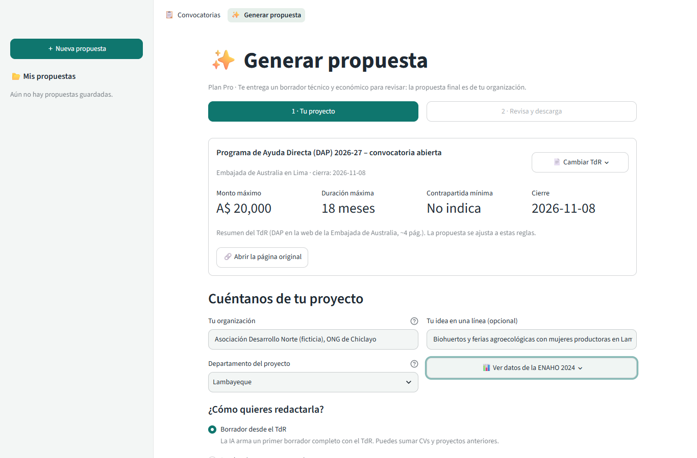
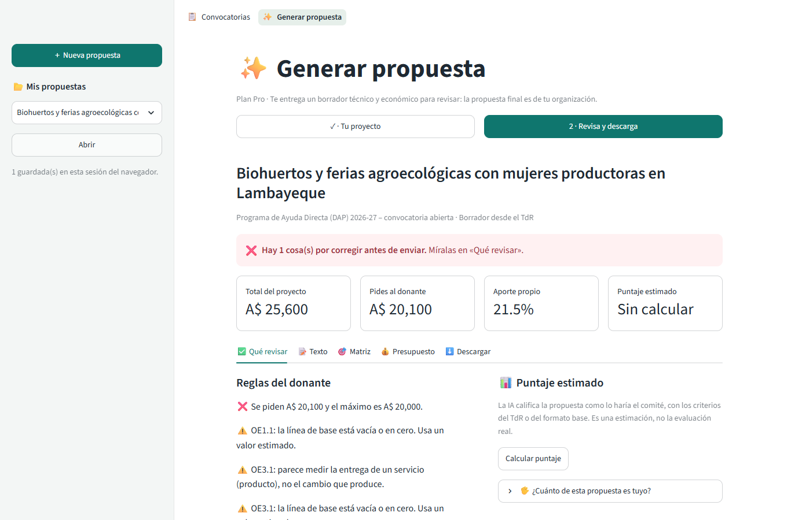
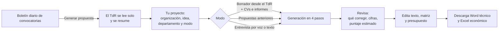
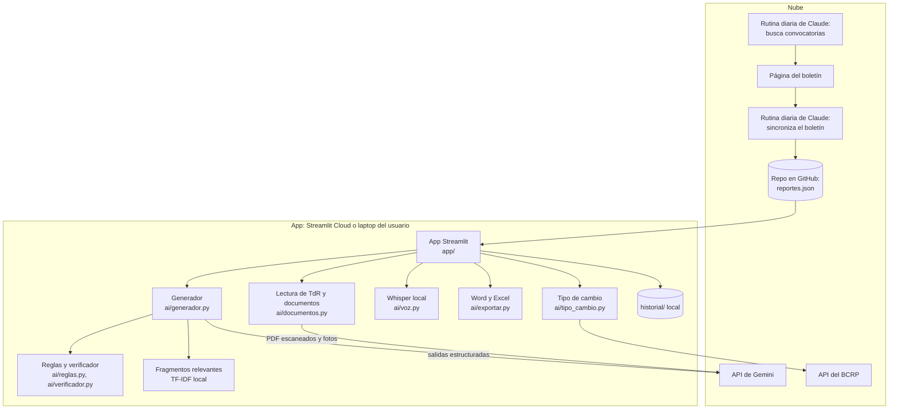

# Generador de propuestas técnicas y económicas para ONG

> Proyecto final de la Diplomatura de Ciencia de Datos para las Ciencias Sociales y la Gestión Pública (Q-Lab PUCP), noviembre de 2026. Prototipo en desarrollo.

## 1. One-liner

**Hacemos propuestas técnicas y económicas listas para revisar para ONG del Perú, a partir del TdR de cada convocatoria, mediante IA que lee las bases, los documentos de la organización y su voz.**

## 2. Founder


**Luis Gabriel Guevara Vega** · Economista (PUCP), colegiado en el Colegio de Economistas de Lima, y especialista en monitoreo y evaluación en una ONG peruana de desarrollo económico que postula cada año a fondos de cooperación. [Portafolio](https://luisguevaravega.github.io)

**Por qué yo:** vivo el problema desde adentro. Veo cómo las convocatorias llegan tarde al equipo, cómo una propuesta toma semanas entre Word, Excel y WhatsApp, y cómo se deja pasar una oportunidad por falta de tiempo. Además, ya construyo productos de datos sobre el Perú (ENAHO, BCRP, imágenes satelitales) con Python, R y Claude Code.

<br clear="left">

**Cómo cubro los cuatro frentes con agentes de IA:**

| Frente | Cómo lo cubro |
|---|---|
| Producto | Claude Code me ayuda a diseñar la guía de entrevistas, transcribir y sintetizar las conversaciones con usuarios y convertir sus pedidos en tareas. |
| Ingeniería | Claude Code escribe y prueba el código (30 pruebas automáticas); dentro de la app, Gemini redacta y Whisper transcribe. |
| Diseño | Claude Code itera la interfaz y la revisa con capturas de un navegador automático antes de cada cambio. |
| Ventas | Una rutina de Claude en la nube arma cada mañana el boletín gratuito de convocatorias, que es el canal de entrada al plan de pago. |

## 3. Problema

**Quién lo sufre:** los gerentes y equipos técnicos de ONG peruanas pequeñas y medianas (desarrollo económico, microfinanzas, empleabilidad) que postulan a fondos de cooperación (BID, AECID, GIZ, embajadas, Fondoempleo) **sin un formulador dedicado**: la propuesta la arma quien tuvo la idea, además de su trabajo diario.

**Son dos problemas encadenados:**

1. **Se enteran tarde.** Las convocatorias están dispersas en decenas de páginas de donantes, agregadores y LinkedIn. Nadie las busca a diario porque el equipo está ocupado con la operación.
2. **No hay tiempo para formular.** Cuando se enteran, quedan pocos días para leer el TdR, seguir el formato del donante, armar el marco lógico, los indicadores y un presupuesto que cuadre con los topes.

**Cuánto les cuesta:**

- **Hasta dos semanas** de trabajo para preparar una propuesta (entrevista 1).
- **Convocatorias perdidas:** "Hemos dejado pasar [convocatorias] por falta de tiempo, sí" (entrevista 1).
- **Consultores externos** cuando no llegan: un costo que depende del tamaño de la convocatoria y que la institución adelanta antes de saber si gana.
- **Observaciones y rechazos** por no cumplir el formato o los topes de las bases.

**Cómo lo resuelven hoy:** Word, Excel, propuestas anteriores copiadas y adaptadas, consultores externos y coordinación por WhatsApp. Cada donante pide su propio formato: "Cada proyecto tiene un formato" (entrevista 1).

**Evidencia:** notas de las conversaciones con usuarios potenciales en [`docs/research/`](docs/research/), con la [guía de entrevista](docs/research/guia_entrevistas.md).

| | Entrevista 1 | Entrevista 2 | Entrevista 3 |
|---|---|---|---|
| Perfil | Gerente general y de microfinanzas, ONG peruana | _pendiente_ | _pendiente_ |
| Propuestas al año / ganadas | ~4 / ~2 | | |
| Tiempo por propuesta | hasta 2 semanas | | |
| Herramientas de hoy | Word; consultores externos | | |
| Dolor principal | falta de tiempo; convocatorias perdidas | | |

## 4. Solución e insight

**El insight.** Desde adentro de una ONG se ve algo que no se ve desde afuera: **las propuestas no se pierden por falta de ideas, sino por llegar tarde y por no cumplir el formato y los topes de cada donante.** Por eso el producto une en un solo flujo lo que hoy está separado: **enterarse a tiempo** (boletín diario) y **formular rápido y bien** (un borrador que respeta el TdR). Un chat de IA genérico puede redactar, pero no busca la convocatoria, no verifica con código que el presupuesto cumpla los topes ni sigue por sí solo el índice que pide cada donante.

**Qué construimos:**

- **Gratis: boletín diario de convocatorias.** Una rutina revisa cada mañana las páginas de donantes, agregadores y LinkedIn; la app acumula el historial y permite buscar y filtrar (por ejemplo, microfinanzas). Las tarjetas muestran el plazo en color.
- **Pro: "Generar propuesta" en un clic desde la convocatoria.**
  - **El TdR se lee solo** y se resume (monto, duración, contrapartida, cierre). Si es un PDF escaneado, pasa por OCR.
  - **Tres modos:** borrador desde el TdR, desde propuestas anteriores (RAG) o entrevista guiada por texto o voz.
  - **Documentos de apoyo:** CVs del equipo y proyectos anteriores. Los CVs alimentan el equipo técnico con nombres y experiencia reales; los proyectos, la experiencia del postor. De los informes largos se toman el comienzo y los fragmentos más relevantes.
  - **Sigue el formato del donante:** si el TdR trae un índice para la propuesta técnica, el Word lo respeta. Si no, usa una estructura de postor: datos de referencia, resumen ejecutivo, comprensión del servicio, objetivos, metodología por momentos, plan por componentes, entregables E1…, cronograma, equipo, riesgos y salvaguardas.
  - **Propuesta económica en Excel** con un resumen por objetivo y por rubro y el detalle con fórmulas.
- **Reglas verificadas con código, no con el prompt:** topes del TdR (financiamiento, contrapartida, reserva, administrativos, duración, personal, rubros y gastos no elegibles), indicadores SMART y un verificador que marca toda cifra del borrador sin fuente.
- **La propuesta es de la organización:** cada sección se edita o se reescribe con una instrucción. La "huella de autoría", visible solo en la app, muestra cuánto salió de la ONG y cuánto de la IA; no aparece en los documentos para el donante.
- **Datos públicos:** indicadores de la ENAHO 2024 por departamento para la sección del problema y tipo de cambio del BCRP.

## 5. Why now

Hace tres años esto no era posible ni barato:

- **Modelos de lenguaje con contexto largo y salidas estructuradas:** hoy leen un TdR de 80 páginas, CVs e informes, y devuelven la propuesta en un formato validado por código, **por centavos de dólar**.
- **IA multimodal:** lee PDF escaneados y fotos sin instalar un OCR aparte.
- **Whisper corre en una laptop:** la voz de la organización se transcribe sin que el audio salga de su computadora.
- **Agentes de programación como Claude Code:** una sola persona construyó este producto, con pruebas, diseño y rutinas automáticas, en una semana. Antes habría requerido un equipo y meses.

## 6. Demo

**Demo en línea:** **https://generador-propuestas-ong.streamlit.app/** (Streamlit Community Cloud; cada visitante ve solo sus propias propuestas).

**Cómo correrlo en local:**

```bash
pip install -r requirements.txt
cp .env.example .env   # y completar GEMINI_API_KEY
streamlit run app/streamlit_app.py
```

Pruebas automáticas, sin llamar a APIs: `python -m pytest` (30 pruebas).

**Capturas del flujo principal** (tomadas de la versión publicada):

| 1. Boletín de convocatorias | 2. Tu proyecto: el TdR ya resumido | 3. Revisa y descarga |
|---|---|---|
|  |  |  |

**Flujo principal:**



**Arquitectura:**



**Modelos y APIs, y por qué:**

| Pieza | Qué usamos | Por qué |
|---|---|---|
| Redacción, reglas del TdR y puntaje | Gemini 3.6 Flash, con modelos de respaldo | Salidas estructuradas (JSON validado con Pydantic), contexto largo y bajo costo; si un modelo se satura, pasa al siguiente. |
| OCR de PDF escaneados y fotos | Gemini Flash-Lite (multimodal) | Lee tablas y documentos torcidos sin instalar nada; cuesta menos de un décimo de centavo por página. |
| Voz a texto | faster-whisper, dentro de la propia app | No se envía el audio a ningún servicio de terceros. En la versión local, el audio ni siquiera sale de la laptop: útil para entrevistas confidenciales. |
| Búsqueda en documentos | TF-IDF (scikit-learn) | Encuentra los fragmentos relevantes sin costo de API y sin enviar todo el documento. |
| Tipo de cambio | API del BCRP | Convierte el presupuesto a la moneda del TdR y a soles con el dato oficial del día. |
| Boletín diario | Rutinas de Claude en la nube | Revisan decenas de fuentes cada mañana sin intervención. |

**Datos de la ENAHO:** la skill de Claude Code `datos-enaho-propuesta` (`.claude/skills/`) baja los microdatos del INEI, calcula los indicadores y los valida contra las cifras oficiales (pobreza 2024: 27.6 % nacional y los 25 departamentos exactos).

## 7. Modelo de negocio

**Quién paga:** la ONG, con una suscripción mensual. El boletín gratuito atrae usuarios; la formulación es de pago.

| Plan | Precio | Qué incluye |
|---|---|---|
| **Gratis** | US$ 0 | Boletín diario de convocatorias con historial y filtros, y 1 propuesta de prueba. |
| **Pro** | **US$ 25 al mes** (≈ S/ 86) | 5 propuestas al mes, los tres modos, documentos de apoyo, OCR y descarga en Word y Excel. Propuesta adicional: US$ 5. |
| **Institucional** | **US$ 50 al mes** (≈ S/ 173) | 15 propuestas al mes, hasta 5 usuarios, historial compartido y formatos específicos de donantes (por ejemplo, Fondoempleo). |

Referencia de valor: hoy una propuesta toma hasta dos semanas de trabajo de un profesional, o un consultor externo cuyo costo crece con el tamaño de la convocatoria. Tipo de cambio de referencia: BCRP, 5 de noviembre de 2026 (S/ 3.452 por dólar).

**Cuánto cuesta cada usuario** (medido por la app: tokens de Gemini en cada llamada, con la tabla de precios de [`data/precios_modelos.json`](data/precios_modelos.json)):

| Acción | Llamadas | Costo aproximado |
|---|---|---|
| Generar una propuesta completa | 4 | US$ 0.03 a 0.09 con documentos normales; hasta ~0.30 con TdR y documentos al máximo |
| OCR de un documento escaneado | 1 | menos de US$ 0.001 por página |
| Auditoría del presupuesto y puntaje estimado | 2 | US$ 0.01 a 0.02 |
| Adaptar al formato Fondoempleo | 1 | US$ 0.01 a 0.03 |
| Voz (Whisper) | 0 | US$ 0: corre en la laptop |

**Margen de contribución:** en el peor caso (US$ 0.30 por propuesta), el plan Pro cuesta US$ 1.50 al mes en IA (margen ≈ 94 %) y el Institucional US$ 4.50 (≈ 91 %), antes del servidor. El servidor de la etapa de validación es gratuito (Streamlit Community Cloud).

## 8. Herramientas del curso

| Herramienta | Sesión | Para qué la usa el producto | Dónde está |
|---|---|---|---|
| Scraping y APIs | 03 | Boletín de convocatorias y descarga del TdR desde el enlace (PDF, Word, HTML, Google Drive) | `data/convocatorias/`, `scripts/actualizar_feed.py`, `ai/documentos.py` |
| APIs públicas (BCRP) | 03 / 04 | Tipo de cambio diario para convertir el presupuesto a la moneda del TdR y a soles | `ai/tipo_cambio.py` |
| Document AI (OCR) | 10 | Leer TdR, CVs e informes escaneados o fotografiados. En el curso se vio PaddleOCR; aquí se usa Gemini multimodal porque ya está conectado, lee tablas y no requiere instalar nada | `ai/llm.py` (`transcribir_documento`), `ai/documentos.py` |
| LLM con salidas estructuradas | 08 | Extraer las reglas del TdR y redactar el diseño técnico, los textos, la matriz y el presupuesto en JSON validado | `ai/esquemas.py`, `ai/generador.py`, `ai/llm.py` |
| RAG | 08 | Reutilizar ideas de propuestas anteriores y tomar los fragmentos más relevantes de informes largos (resultados, metodología, equipo, lecciones), citando cada fuente | `ai/documentos.py` (`Recuperador`), `ai/generador.py` (`fragmentos_previos`, `seleccionar_texto`) |
| Evaluación de productos de datos | 12 | Pruebas automáticas, verificador de cifras sin fuente y puntaje con los criterios del donante | `tests/`, `ai/verificador.py`, `ai/auditor.py` |
| Voz a texto con Whisper | 13 | Responder la entrevista hablando y transcribir las entrevistas con usuarios, sin que el audio salga de la laptop | `ai/voz.py` |
| Skills de Claude Code con la ENAHO | 16 | Indicadores de pobreza, desempleo e informalidad juvenil por departamento, validados contra el INEI | `.claude/skills/datos-enaho-propuesta/`, `ai/enaho.py` |
| Claude Code como socio técnico | 16 | Construcción del producto y rutinas en la nube para el boletín | todo el repo; ver la sección 9 |

## 9. Qué hizo el agente

Claude Code (Claude Opus) fue el co-founder técnico. **Luis** definió el problema, las decisiones de producto y de negocio, hizo las entrevistas y revisó cada entrega. **Claude Code**:

- **Escribió el código del producto:** la app de Streamlit (`app/`), el motor de generación, las reglas, el verificador, la lectura de documentos con OCR y la exportación a Word y Excel (`ai/`).
- **Escribió las 30 pruebas automáticas** (`tests/`) y las corrió después de cada cambio.
- **Construyó la skill de la ENAHO** (`.claude/skills/datos-enaho-propuesta/`): descarga, cálculo y validación contra el INEI.
- **Armó la automatización del boletín:** el script `scripts/actualizar_feed.py` y la rutina en la nube que lo sincroniza cada mañana.
- **Iteró el diseño:** revisó la interfaz con capturas de un navegador automático y corrigió lo que se veía mal (cifras cortadas, anchos, textos confusos).
- **Probó el flujo con convocatorias reales** y generó propuestas de ejemplo para revisar el Word y el Excel.
- **Apoyó la investigación con usuarios:** la guía de entrevista, la transcripción local con Whisper y las notas anonimizadas.
- **Redactó este README** a partir de las decisiones de Luis.

## Datos y privacidad

Solo datos públicos (bases de Fondoempleo y del BMZ, convocatorias publicadas, ENAHO 2024 agregada por departamento, tipo de cambio del BCRP) y casos de ejemplo sintéticos. No se suben al repo los microdatos de la ENAHO (`datos/`), el historial de propuestas (`historial/`) ni los audios y transcripciones de entrevistas (`privado/`). Las notas de entrevistas están anonimizadas y se tomaron con consentimiento.

## Licencia

MIT. Ver [LICENSE](LICENSE).
